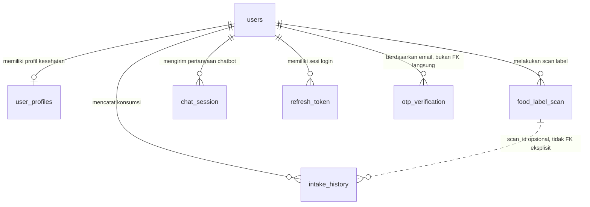

# Dokumentasi Teknis Database dan Alur Data SKENNA

Dokumen ini dibuat berdasarkan inspeksi kode aktual project SKENNA di repository lokal. Fokus dokumen ini adalah desain database, relasi data, alur runtime yang menyentuh database, dan implikasi desain yang belum dijelaskan detail pada dokumentasi lama.

Catatan awal: file `dokumentasi_lama.docx` atau `dokumentasi_lama.md` tidak ditemukan di workspace maupun folder attachment yang dapat diakses. Sebagai pengganti, dokumen lama yang terbaca adalah `skenna/docs/architecture.md`, `skenna/docs/api-spec.md`, dan `skenna/docs/rag-design.md`. Dokumen lama tersebut masih sangat ringkas, misalnya `architecture.md` masih menyebut PostgreSQL/SQLite, sedangkan kode aktual memakai MySQL melalui `mysql+pymysql`.

## 1. Sumber Kode yang Diaudit

Sumber utama yang digunakan:

- Model SQLAlchemy: `skenna/skenna_backend/app/models/*.py`
- Migration Alembic: `skenna/skenna_backend/migrations/versions/*.py`
- Schema Pydantic: `skenna/skenna_backend/app/schemas/*.py`
- Router API: `skenna/skenna_backend/app/api/v1/*.py`
- Repository/service: `skenna/skenna_backend/app/repositories/*.py`, `skenna/skenna_backend/app/services/*.py`
- Config rules Flutter: `skenna/frontend/assets/rules/sodium_rules.json`, `skenna/frontend/assets/rules/ui_rules.json`
- Client Flutter: `skenna/frontend/lib/data/api_client.dart`

### Temuan Penting dari Audit Awal

Database runtime yang digunakan backend adalah MySQL, bukan PostgreSQL/SQLite. Hal ini terlihat dari default `DATABASE_URL` di `app/core/config.py`, `alembic.ini`, dan `docker-compose.yml`.

Ada perbedaan antara model SQLAlchemy saat ini dan migration Alembic. Beberapa kolom pada model `food_label_scan` dan `intake_history` ada di kode model, tetapi tidak dibuat oleh migration awal. Pada startup, backend memanggil `Base.metadata.create_all(bind=engine)`, sehingga database lokal bisa tetap berjalan walaupun migration tidak lengkap. Namun untuk deployment production yang mengandalkan Alembic, ini perlu diperhatikan.

### Kemungkinan Pertanyaan Sidang

**Q: Mengapa dokumentasi ini tidak mengulang isi arsitektur lama?**  
A: Karena file lama yang ditemukan hanya menjelaskan komponen dan flow umum secara singkat. Dokumen ini fokus pada desain database, alasan relasi, trade-off, dan edge case yang belum dijabarkan.

**Q: Apa risiko terbesar dari audit awal?**  
A: Risiko terbesar adalah ketidaksinkronan model SQLAlchemy dengan migration Alembic, terutama pada tabel `food_label_scan` dan `intake_history`.

**Q: Apakah database benar-benar MySQL?**  
A: Ya. Kode memakai `mysql+pymysql` dan migration juga memakai dialect MySQL pada beberapa bagian.

## 2. ERD Tingkat Tinggi

Relasi utama sistem berpusat pada tabel `users`. Hampir semua data operasional memiliki `user_id` agar data dapat dipisahkan per pengguna. `user_profiles` bersifat one-to-one terhadap `users`, sedangkan scan, konsumsi, chat, dan refresh token bersifat one-to-many.

`otp_verification` memakai `email`, bukan `user_id`. Ini masuk akal karena OTP juga dipakai pada fase sebelum user selesai dibuat atau pada reset password berbasis email.

### Kemungkinan Pertanyaan Sidang

**Q: Mengapa `FoodLabelScan` ke `IntakeHistory` digambar garis putus-putus?**  
A: Karena `IntakeHistory.scan_id` ada di model, tetapi tidak dideklarasikan sebagai `ForeignKey`. Secara konsep terhubung, tetapi database tidak menegakkan referential integrity.

**Q: Apakah ada many-to-many relationship?**  
A: Tidak ditemukan. Semua relasi yang ada adalah one-to-one atau one-to-many.

**Q: Mengapa semua data operasional tidak disatukan saja di tabel `users`?**  
A: Karena scan, konsumsi, chat, token, dan OTP adalah data berulang. Jika disimpan di `users`, tabel user akan membengkak dan tidak normal secara desain relasional.

## 3. Tabel Relasi Database

Format tabel berikut mengikuti struktur model SQLAlchemy aktual. Kolom `Constraint` merangkum primary key, nullable, default, dan index bila terlihat dari model. Kolom `Relasi` menjelaskan foreign key atau relasi konseptual.

### 3.1 `users`

Tujuan: menyimpan identitas akun, email login, hash password, dan waktu pembuatan akun.

| Nama Tabel | Kolom | Tipe | Constraint | Relasi |
|---|---|---|---|---|
| `users` | `id` | `Integer` | Primary key, index | Direferensikan oleh `user_profiles.user_id`, `food_label_scan.user_id`, `intake_history.user_id`, `chat_session.user_id`, `refresh_token.user_id` |
| `users` | `full_name` | `String(120)` | Not null secara model | Digunakan sebagai nama tampilan user |
| `users` | `email` | `String(120)` | Unique, index | Digunakan juga oleh `otp_verification.email` secara konseptual |
| `users` | `hashed_password` | `String(255)` | Not null secara model | Tidak menyimpan password plaintext |
| `users` | `created_at` | `DateTime` | Default `wib_now` | Timestamp pembuatan user |

Index `email` dibuat karena login dan registrasi perlu mencari user berdasarkan email. Index `id` mengikuti pola primary key/index di model.

Cardinality:

- `users` ke `user_profiles`: one-to-one, karena `user_profiles.user_id` unique.
- `users` ke `food_label_scan`: one-to-many, karena satu user dapat melakukan banyak scan.
- `users` ke `intake_history`: one-to-many, karena satu user dapat mencatat banyak konsumsi.
- `users` ke `chat_session`: one-to-many, karena satu user dapat memiliki banyak percakapan.
- `users` ke `refresh_token`: one-to-many, karena user bisa login beberapa kali atau memiliki token aktif di beberapa perangkat.

### 3.2 `user_profiles`

Tujuan: menyimpan data kesehatan yang dipakai untuk personalisasi batas natrium dan konteks chatbot.

| Nama Tabel | Kolom | Tipe | Constraint | Relasi |
|---|---|---|---|---|
| `user_profiles` | `id` | `Integer` | Primary key, index | Identitas internal profil |
| `user_profiles` | `user_id` | `ForeignKey(users.id)` | Unique, index, cascade delete | One-to-one ke `users` |
| `user_profiles` | `gender` | `String(20)` | Not null secara model | Dipakai rule natrium dan status kehamilan |
| `user_profiles` | `birth_date` | `Date` | Not null secara model | Dipakai menghitung usia |
| `user_profiles` | `has_hypertension` | `Boolean` | Default `False` | Dipakai klasifikasi batas natrium |
| `user_profiles` | `hypertension_condition` | `String(50)` | Nullable | `history_only`, `controlled`, `uncontrolled` menurut schema |
| `user_profiles` | `systolic_pressure` | `Integer` | Nullable | Dipakai UI/ESC category, bukan FK |
| `user_profiles` | `diastolic_pressure` | `Integer` | Nullable | Dipakai UI/ESC category, bukan FK |
| `user_profiles` | `pregnancy_status` | `String(50)` | Nullable | `pregnant`, `breastfeeding`, `none` menurut schema |
| `user_profiles` | `updated_at` | `DateTime` | Default dan `onupdate` `wib_now` | Audit waktu update profil |

Kenapa one-to-one? Satu akun hanya membutuhkan satu profil kesehatan aktif. Riwayat perubahan profil tidak disimpan sebagai tabel historis, sehingga update profil menimpa nilai lama.

Implikasi query: karena `user_id` unique dan index, pengambilan profil per user cepat dan sederhana. Kekurangannya, sistem tidak dapat menjawab pertanyaan historis seperti "berapa batas natrium user saat scan lama dilakukan" kecuali nilai itu disalin ke tabel history pada saat kejadian.

### 3.3 `food_label_scan`

Tujuan: menyimpan hasil ekstraksi label gizi dari fitur scan. Tabel ini merekam fakta hasil scan: gambar, raw text, natrium, takaran saji, porsi per kemasan, dan metadata produk.

| Nama Tabel | Kolom | Tipe | Constraint | Relasi |
|---|---|---|---|---|
| `food_label_scan` | `id` | `Integer` | Primary key, index | Dapat direferensikan secara konseptual oleh `intake_history.scan_id` |
| `food_label_scan` | `user_id` | `ForeignKey(users.id)` | Index, cascade delete | Many-to-one ke `users` |
| `food_label_scan` | `image_path` | `Text` | Not null secara model | Path file hasil upload di `/uploads` |
| `food_label_scan` | `raw_text` | `Text` | Not null secara model | Output teks/JSON mentah dari OCR/Gemini |
| `food_label_scan` | `sodium_mg` | `Float` | Not null secara model | Natrium per sajian dari label |
| `food_label_scan` | `scanned_at` | `DateTime` | Default waktu WIB | Waktu scan |
| `food_label_scan` | `takaran_saji` | `Integer` | Nullable | Takaran per sajian, misalnya 30 |
| `food_label_scan` | `sajian_per_kemasan` | `Integer` | Nullable | Jumlah sajian per kemasan |
| `food_label_scan` | `satuan_takaran` | `String(10)` | Nullable | `g` atau `ml` |
| `food_label_scan` | `nama_produk` | `String(200)` | Nullable | Nama produk hasil Gemini atau fallback raw text |
| `food_label_scan` | `kategori` | `String(50)` | Nullable | Kategori produk, diisi/diupdate dari UI |
| `food_label_scan` | `isi_kemasan` | `Float` | Nullable | `takaran_saji * sajian_per_kemasan` jika tersedia |
| `food_label_scan` | `isi_kemasan_satuan` | `String(5)` | Nullable, default `'g'` | Satuan isi kemasan |

Relasi `users -> food_label_scan` adalah one-to-many karena satu user dapat melakukan banyak scan label makanan dari waktu ke waktu. Index `user_id` mendukung query riwayat scan per user. Index `id` mendukung lookup satu scan.

Catatan migration: initial migration hanya membuat `id`, `user_id`, `image_path`, `raw_text`, `sodium_mg`, dan `scanned_at`. Kolom `takaran_saji`, `sajian_per_kemasan`, `satuan_takaran`, `nama_produk`, `kategori`, `isi_kemasan`, dan `isi_kemasan_satuan` tidak ditemukan dibuat oleh `op.create_table` atau `op.add_column`. Migration `bdf12fe9ae2d` hanya melakukan `alter_column` pada `takaran_saji` dan `satuan_takaran`, sehingga migration tersebut mengasumsikan kolom sudah ada. [PERLU DIKONFIRMASI: apakah database production dibuat dengan Alembic murni atau pernah memakai `Base.metadata.create_all`.]

### 3.4 `intake_history`

Tujuan: menyimpan catatan konsumsi dan status apakah produk yang discan benar-benar dikonsumsi. Tabel ini menjadi sumber utama dashboard "Batas Natrium Hari Ini".

| Nama Tabel | Kolom | Tipe | Constraint | Relasi |
|---|---|---|---|---|
| `intake_history` | `id` | `Integer` | Primary key, index | Identitas catatan konsumsi |
| `intake_history` | `user_id` | `ForeignKey(users.id)` | Index, cascade delete | Many-to-one ke `users` |
| `intake_history` | `food_name` | `String(120)` | Not null secara model | Nama makanan/produk |
| `intake_history` | `kategori` | `String(50)` | Nullable | Kategori produk |
| `intake_history` | `scan_id` | `Integer` | Nullable, bukan FK eksplisit | Relasi konseptual ke `food_label_scan.id` |
| `intake_history` | `image_path` | `String(255)` | Nullable | Gambar produk pertama |
| `intake_history` | `image_path2` | `String(255)` | Nullable | Gambar produk kedua untuk perbandingan |
| `intake_history` | `sodium_mg` | `Float` | Not null secara model | Natrium produk utama |
| `intake_history` | `sodium_level` | `String(20)` | Not null secara model | Level hasil klasifikasi |
| `intake_history` | `servings` | `Integer` | Default `1` | Jumlah sajian yang dikonsumsi |
| `intake_history` | `is_consumed` | `Boolean` | Default `False`, nullable `False` | Status apakah dicatat sebagai konsumsi |
| `intake_history` | `consumed_at` | `DateTime` | Default waktu WIB | Waktu konsumsi atau waktu catatan dibuat |
| `intake_history` | `type` | `String(50)` | Default `"single"` melalui atribut `intake_type` | `single` atau mode perbandingan |
| `intake_history` | `product_name2` | `String(120)` | Nullable | Nama produk kedua |
| `intake_history` | `sodium_mg2` | `Float` | Nullable | Natrium produk kedua |
| `intake_history` | `package_ml` | `Integer` | Default `0` | Ukuran/takaran produk utama |
| `intake_history` | `portions_in_package` | `Integer` | Default `1` | Porsi per kemasan produk utama |
| `intake_history` | `satuan_takaran` | `String(20)` | Default `"g"` | Satuan produk utama |
| `intake_history` | `package_ml2` | `Integer` | Default `0` | Ukuran/takaran produk kedua |
| `intake_history` | `portions_in_package2` | `Integer` | Default `1` | Porsi per kemasan produk kedua |
| `intake_history` | `satuan_takaran2` | `String(20)` | Default `"g"` | Satuan produk kedua |
| `intake_history` | `rekomendasi_json` | `Text` | Nullable | Cache rekomendasi produk dari Gemini |

Relasi `users -> intake_history` adalah one-to-many karena satu user memiliki banyak catatan konsumsi. `scan_id` dibuat integer nullable, tetapi tidak memakai `ForeignKey`; artinya database tidak mencegah `scan_id` menunjuk ke scan yang tidak ada. Desain ini fleksibel untuk input manual atau history hasil perbandingan, tetapi integritas relasional lebih lemah.

Catatan migration: initial migration hanya membuat `id`, `user_id`, `food_name`, `sodium_mg`, `sodium_level`, dan `consumed_at`. Banyak kolom model modern tidak ditemukan pada migration, misalnya `kategori`, `scan_id`, `image_path`, `servings`, `is_consumed`, `type`, `product_name2`, dan `rekomendasi_json`. [PERLU DIKONFIRMASI: apakah schema database lokal sudah terbentuk dari `create_all` sehingga berbeda dari Alembic.]

### 3.5 `chat_session`

Tujuan: menyimpan histori tanya-jawab chatbot Skenny.

| Nama Tabel | Kolom | Tipe | Constraint | Relasi |
|---|---|---|---|---|
| `chat_session` | `id` | `Integer` | Primary key, index | Identitas pesan |
| `chat_session` | `user_id` | `ForeignKey(users.id)` | Index, cascade delete | Many-to-one ke `users` |
| `chat_session` | `question` | `Text` | Not null secara model | Pertanyaan user |
| `chat_session` | `answer` | `Text` | Not null secara model | Jawaban Gemini/RAG |
| `chat_session` | `sources` | `Text` | Default `"[]"` | Sumber retrieval disimpan sebagai string JSON |
| `chat_session` | `created_at` | `DateTime` | Default `datetime.utcnow` | Waktu pesan |

Relasi one-to-many karena satu user bisa bertanya banyak kali. Index `user_id` membantu sidebar chat dan history filter per user.

### 3.6 `refresh_token`

Tujuan: menyimpan token refresh yang sudah di-hash untuk menjaga sesi login jangka panjang.

| Nama Tabel | Kolom | Tipe | Constraint | Relasi |
|---|---|---|---|---|
| `refresh_token` | `id` | `Integer` | Primary key, autoincrement | Identitas token |
| `refresh_token` | `user_id` | `Integer`, `ForeignKey(users.id)` | Not null, index, cascade delete | Many-to-one ke `users` |
| `refresh_token` | `token_hash` | `String(255)` | Not null, index | Lookup token aktif tanpa menyimpan raw token |
| `refresh_token` | `created_at` | `DateTime` | Not null | Waktu token dibuat |
| `refresh_token` | `expires_at` | `DateTime` | Not null | Waktu token kedaluwarsa |
| `refresh_token` | `revoked_at` | `DateTime` | Nullable | Diisi saat logout/revoke |

Kenapa dipisah dari tabel `users`? Karena satu user dapat memiliki lebih dari satu refresh token, misalnya login di dua perangkat atau login ulang sebelum token lama dicabut. Jika token disimpan sebagai satu kolom di `users`, sistem sulit mengelola multi-device session, revoke per perangkat, dan audit token.

Index `token_hash` penting karena endpoint `/auth/refresh` mencari token berdasarkan hash. Token raw tidak disimpan untuk mengurangi risiko jika database bocor.

### 3.7 `otp_verification`

Tujuan: menyimpan OTP register, verifikasi email, atau reset password.

| Nama Tabel | Kolom | Tipe | Constraint | Relasi |
|---|---|---|---|---|
| `otp_verification` | `id` | `Integer` | Primary key, autoincrement | Identitas OTP |
| `otp_verification` | `email` | `String(120)` | Not null, index | Relasi konseptual ke `users.email`, bukan FK |
| `otp_verification` | `otp_code` | `String(6)` | Not null | Kode OTP |
| `otp_verification` | `created_at` | `DateTime` | Not null | Waktu dibuat |
| `otp_verification` | `expired_at` | `DateTime` | Not null | Berlaku 5 menit menurut kode auth |
| `otp_verification` | `is_used` | `Boolean` | Default `False` | Menandai OTP sudah dipakai |

Relasi memakai email karena OTP bisa dibuat sebelum user ada di tabel `users`. Ini cocok untuk register. Untuk reset password, endpoint mengecek user berdasarkan email terlebih dahulu.

### Kemungkinan Pertanyaan Sidang

**Q: Mengapa `RefreshToken` tidak cukup disimpan di tabel `users`?**  
A: Karena refresh token adalah data sesi yang bisa lebih dari satu per user. Tabel terpisah memungkinkan revoke, expiry, dan multi-device session.

**Q: Mengapa `scan_id` di `intake_history` tidak dibuat foreign key?**  
A: Kode saat ini hanya menyimpannya sebagai integer opsional. Ini memberi fleksibilitas untuk input manual, tetapi trade-off-nya integritas database tidak dijaga otomatis.

**Q: Apa dampak migration tidak sinkron dengan model?**  
A: Deployment baru yang hanya menjalankan Alembic bisa gagal atau menghasilkan tabel yang tidak punya kolom yang dibutuhkan runtime.

## 4. FoodLabelScan vs IntakeHistory

`FoodLabelScan` dan `IntakeHistory` sengaja mewakili dua kejadian berbeda.

`FoodLabelScan` adalah bukti hasil pembacaan label. Fokusnya adalah "produk ini pernah discan dan hasil OCR/Gemini-nya seperti ini". Belum tentu user benar-benar memakan produk tersebut.

`IntakeHistory` adalah catatan konsumsi. Fokusnya adalah "produk ini masuk ke perhitungan konsumsi natrium user". Karena itu ada `is_consumed`, `servings`, `consumed_at`, dan data perbandingan produk kedua.

Alasan dipisah:

- Scan dapat gagal atau tidak lengkap. Kode `cv.py` mengembalikan `scan_id=None` bila `takaran_saji` atau `sajian_per_kemasan` tidak terbaca.
- User bisa scan produk hanya untuk mengecek natrium tanpa mengonsumsinya.
- Riwayat konsumsi membutuhkan status dan jumlah sajian, sedangkan scan hanya menyimpan hasil ekstraksi label.
- Produk hasil perbandingan bisa masuk history tanpa harus punya dua record `FoodLabelScan` yang lengkap.

Trade-off:

- Kelebihan: data scan dan konsumsi tidak tercampur, dashboard lebih mudah menghitung konsumsi nyata.
- Kekurangan: ada potensi duplikasi kolom seperti nama produk, natrium, kategori, image path, dan takaran.
- Kekurangan lain: karena `scan_id` bukan foreign key eksplisit, hubungan scan-ke-intake harus dijaga oleh aplikasi, bukan database.

### `consumed_at` dan Null Handling

Pada model, `consumed_at` memiliki default waktu WIB dan tidak ditandai `nullable=True`. Namun beberapa query tetap memperlakukan `consumed_at` sebagai nilai yang mungkin `None`.

Contoh handling:

- `_intake_to_dict()` mengembalikan `None` bila `item.consumed_at` kosong.
- Dashboard melewati item bila `consumed_at is None`.
- `get_scan_history()` memberi timestamp 0 bila timestamp kosong agar sorting tidak crash.

Mengapa kode defensif ini masuk akal? Kemungkinan karena database lama/migration manual dapat memiliki baris historis dengan `consumed_at` null, atau karena schema Alembic tidak sepenuhnya sinkron dengan model. Jadi meskipun model modern punya default, endpoint tetap aman terhadap data lama.

### Flow `is_consumed`

Alur yang terlihat dari kode:

1. User scan produk melalui `/api/v1/cv/scan`.
2. Backend menyimpan `FoodLabelScan` bila data wajib terbaca.
3. Saat user memilih mencatat konsumsi, Flutter memanggil `POST /api/v1/history/intake`.
4. Record `IntakeHistory` dibuat dengan `is_consumed` dari payload; default schema adalah `False`.
5. Jika user kemudian mengubah status konsumsi, Flutter memanggil `PATCH /api/v1/history/intake/{intake_id}`.
6. Repository mengubah `is_consumed`; jika `servings` dikirim, `consumed_at` diperbarui ke waktu WIB saat update.

Kenapa desain POST-on-scan lalu PATCH-to-update masuk akal? Karena keputusan konsumsi sering terjadi setelah user melihat hasil analisis. User perlu melihat natrium, rekomendasi, dan peringatan dahulu sebelum memastikan produk dikonsumsi.

### Kemungkinan Pertanyaan Sidang

**Q: Kenapa scan tidak langsung dianggap konsumsi?**  
A: Karena user mungkin hanya mengecek label. Konsumsi adalah keputusan terpisah setelah hasil scan ditampilkan.

**Q: Kenapa `FoodLabelScan` dan `IntakeHistory` punya kolom yang mirip?**  
A: Karena `IntakeHistory` menyimpan snapshot konsumsi agar riwayat tetap stabil meskipun data scan atau profil berubah.

**Q: Apa risiko `scan_id` bukan foreign key?**  
A: Database tidak bisa mencegah referensi scan yang tidak valid. Validasi harus dilakukan di level aplikasi.

## 5. Alur Data Scan End-to-End

Alur scan berdasarkan `cv.py`, `cv_ocr_service.py`, `gemini_service.py`, dan `api_client.dart`:

1. Flutter membaca file gambar dari path lokal.
2. Flutter encode gambar menjadi base64 dan mengirim ke `POST /api/v1/cv/scan`.
3. Backend decode base64, resize/kompres memakai Pillow, lalu menyimpan gambar ke folder `uploads`.
4. Backend re-encode gambar terkompresi ke base64.
5. `CVOcrService.scan_label()` mengirim gambar ke Gemini Vision.
6. Gemini diminta mengembalikan JSON berisi `takaran_saji`, `satuan_takaran`, `sajian_per_kemasan`, dan `sodium_mg`.
7. Backend parsing JSON. Jika parsing gagal, fallback regex hanya mencoba membaca sodium/natrium mg.
8. Jika `takaran_saji` atau `sajian_per_kemasan` null, endpoint mengembalikan `scan_id=None` dan tidak menyimpan record scan valid.
9. Jika valid, backend hitung `sodium_level` berdasarkan profil user.
10. Backend menyimpan `FoodLabelScan`.
11. Flutter menampilkan hasil scan dan dapat mengirim `POST /history/intake` bila user mencatat konsumsi.
12. Dashboard dan history membaca `IntakeHistory`, bukan hanya `FoodLabelScan`.

Validasi null pada step 8 penting karena total natrium per kemasan dan konteks konsumsi bergantung pada takaran dan jumlah sajian. Menyimpan scan yang kehilangan dua field itu akan membuat UI berpotensi menampilkan angka yang menyesatkan.

### Implikasi Performance

- Kompresi gambar mengurangi ukuran payload ke Gemini, sehingga latency dan biaya request bisa lebih terkendali.
- Menyimpan `image_path`, bukan blob gambar di MySQL, menjaga ukuran database tetap kecil.
- Query dashboard saat ini mengambil semua intake user melalui `HistoryRepository.list_intake()` lalu menghitung filter hari ini di Python. Untuk data kecil ini sederhana; untuk data besar, lebih efisien jika agregasi dilakukan langsung di SQL dengan filter tanggal dan `is_consumed=True`.

### Kemungkinan Pertanyaan Sidang

**Q: Mengapa gambar disimpan sebagai file, bukan langsung di database?**  
A: File gambar bisa besar. Menyimpan path di database mengurangi beban MySQL dan membuat backup database lebih ringan.

**Q: Mengapa scan gagal jika takaran saji tidak terbaca?**  
A: Karena tanpa takaran saji dan jumlah sajian, sistem tidak punya dasar kuat untuk menghitung konteks konsumsi.

**Q: Apa bottleneck utama fitur scan?**  
A: Request Gemini Vision dan upload/kompresi gambar, bukan query database.

## 6. Konfigurasi Rule Natrium sebagai JSON, Bukan Tabel

Project menyimpan aturan natrium dan UI kategori di:

- `frontend/assets/rules/sodium_rules.json`
- `frontend/assets/rules/ui_rules.json`

Isi `sodium_rules.json` mencakup referensi AKG, WHO, AHA, ESC, dan kelompok usia. `ui_rules.json` memetakan category key seperti `normal_anak`, `normal_dewasa`, `hipertensi_dewasa`, `hamil_dewasa`, dan lainnya ke teks UI, warna, dan box informasi.

Kenapa bukan tabel database?

- Rule ini lebih mirip konfigurasi statis aplikasi daripada data user.
- Flutter membutuhkan rule untuk menampilkan hasil lokal tanpa selalu menunggu backend.
- Versi rule dapat ikut versioning source code sehingga perubahan bisa direview melalui Git.
- Tidak perlu admin panel atau CRUD rule pada runtime.

Trade-off:

- Kelebihan: cepat dibaca, mudah dibundel di app, tidak perlu query DB.
- Kelebihan: cocok untuk rule yang jarang berubah.
- Kekurangan: perubahan rule membutuhkan update aplikasi atau deploy kode.
- Kekurangan: backend dan frontend bisa drift bila tabel/rule diduplikasi manual.

Catatan penting: backend juga memiliki rule hardcoded di `sodium_limit_service.py`. Ini berarti ada dua sumber aturan: JSON Flutter dan Python backend. Risiko desainnya adalah ketidaksamaan interpretasi antara hasil yang dihitung di frontend dan backend.

### Kemungkinan Pertanyaan Sidang

**Q: Mengapa rule tidak disimpan di database agar mudah diubah?**  
A: Karena rule bersifat statis dan perlu ikut versioning aplikasi. Database lebih cocok untuk data user dan transaksi.

**Q: Apa risiko rule berbasis JSON?**  
A: Jika backend dan frontend punya salinan rule sendiri, keduanya bisa tidak sinkron.

**Q: Kapan rule sebaiknya dipindah ke database?**  
A: Jika sistem membutuhkan admin panel, audit perubahan rule, atau update rule tanpa rilis aplikasi.

## 7. Alur Autentikasi: Access Token dan Refresh Token

Backend membuat dua token saat login:

- `access_token`: JWT untuk autentikasi request API.
- `refresh_token`: token acak yang raw value dikirim ke client, sedangkan hash-nya disimpan di tabel `refresh_token`.

Kenapa perlu dua token?

- Access token biasanya berumur pendek agar risiko penyalahgunaan lebih kecil.
- Refresh token berumur lebih panjang dan dipakai hanya untuk meminta access token baru.
- Refresh token dapat dicabut dengan mengisi `revoked_at`, sedangkan JWT access token sulit dicabut tanpa blacklist.

Alur `_sendWithAuthRetry()` di Flutter:

1. Client mengirim request dengan header `Authorization: Bearer <access_token>`.
2. Jika response bukan `401`, response langsung dikembalikan.
3. Jika response `401`, client memanggil `_tryRefreshToken()`.
4. `_tryRefreshToken()` mengirim refresh token ke `/api/v1/auth/refresh`.
5. Jika berhasil, access token baru disimpan.
6. Request awal dicoba ulang dengan token baru.
7. Jika refresh gagal, local session dibersihkan dan user diminta login ulang.

Relasi database: `refresh_token.user_id` many-to-one ke `users.id`. Tabel ini juga mendukung logout, karena `/auth/logout` mencari refresh token aktif lalu mengisi `revoked_at`.

### Kemungkinan Pertanyaan Sidang

**Q: Mengapa refresh token disimpan dalam bentuk hash?**  
A: Agar jika database bocor, penyerang tidak langsung mendapat raw token yang bisa dipakai.

**Q: Mengapa access token tidak disimpan di database?**  
A: Access token JWT bisa diverifikasi dari signature dan payload. Database hanya perlu menyimpan refresh token untuk sesi jangka panjang dan revoke.

**Q: Apa yang terjadi jika access token expired?**  
A: Client otomatis refresh token dan mengulang request melalui `_sendWithAuthRetry()`.

## 8. Alur RAG Chatbot Skenny dan Keterkaitan Database

RAG chatbot menyentuh dua jenis data:

- Data retrieval dari ChromaDB/knowledge base hipertensi.
- Data personal dari MySQL, terutama profil user dan histori scan/konsumsi.

Source retrieval berasal dari pipeline `skenna_python/rag`, khususnya chunk hipertensi di folder `chunks/hipertensi` dan Chroma persistent store. Backend memanggil `RAGService.retrieve_context()` untuk mencari konteks berbasis embedding.

Konteks user masuk ke prompt lewat service personalisasi. Kode membaca profil kesehatan user dari `UserRepository.get_profile()`, lalu menambahkan informasi seperti usia, hipertensi, tekanan darah, status kehamilan, dan riwayat produk bila relevan.

Hasil chat disimpan di `chat_session`:

- `question`: pertanyaan user.
- `answer`: jawaban chatbot.
- `sources`: sumber retrieval sebagai teks JSON.
- `created_at`: waktu pesan.

Desain ini membuat histori chatbot dapat ditampilkan ulang tanpa memanggil Gemini lagi. Trade-off-nya, jawaban lama tidak otomatis berubah jika knowledge base diperbarui.

### Kemungkinan Pertanyaan Sidang

**Q: Mengapa sumber RAG tidak disimpan di MySQL?**  
A: Karena retrieval semantic membutuhkan vector search. ChromaDB lebih sesuai untuk embedding dan similarity search.

**Q: Mengapa chat tetap disimpan di MySQL?**  
A: Karena chat history adalah data transaksi per user yang cocok untuk relational database.

**Q: Apakah jawaban lama ikut berubah jika knowledge base diperbarui?**  
A: Tidak. Jawaban lama tersimpan sebagai snapshot di `chat_session`.

## 9. Cache Rekomendasi Produk di `rekomendasi_json`

Saat `POST /api/v1/history/intake`, backend mencoba memanggil `get_rekomendasi()` lalu menyimpan hasilnya ke `item.rekomendasi_json` dalam bentuk JSON string.

Alasan desain:

- Rekomendasi dari Gemini berbiaya dan berlatensi lebih tinggi daripada query database.
- Menyimpan hasil rekomendasi membuat halaman history/detail bisa menampilkan rekomendasi lama tanpa memanggil Gemini ulang.
- Cache menjaga pengalaman user lebih stabil: rekomendasi yang dilihat saat mencatat konsumsi tetap sama saat dibuka kembali.

Trade-off:

- Data bisa tidak fresh jika produk baru muncul atau prompt rekomendasi diperbaiki.
- JSON string tidak mudah di-query secara relasional dibanding tabel `recommendation_items`.
- Validasi schema rekomendasi bergantung pada kode aplikasi, bukan constraint database.

Alternatif yang tidak dipilih:

- Tabel rekomendasi terpisah: lebih rapi untuk query, tetapi lebih banyak join dan migration.
- Tidak menyimpan cache: selalu fresh, tetapi lebih mahal dan lambat.
- Cache in-memory saja: cepat, tetapi hilang saat server restart dan tidak muncul di history lama.

### Kemungkinan Pertanyaan Sidang

**Q: Mengapa rekomendasi disimpan sebagai JSON, bukan tabel?**  
A: Karena rekomendasi dipakai sebagai snapshot tampilan, bukan data yang sering di-query per field.

**Q: Apa kelemahan menyimpan JSON string?**  
A: Sulit difilter atau dianalisis dengan SQL, dan tidak ada constraint kolom untuk struktur item rekomendasi.

**Q: Mengapa rekomendasi tidak selalu dibuat ulang?**  
A: Untuk mengurangi latency, biaya API Gemini, dan menjaga konsistensi tampilan history.

## 10. Sinkronisasi Model dan Migration

Bagian ini penting untuk deployment. Model SQLAlchemy saat ini lebih kaya daripada migration Alembic yang tersedia.

### Tabel yang Relatif Sesuai

- `users`: migration initial membuat kolom inti.
- `chat_session`: migration initial membuat kolom inti.
- `refresh_token`: migration `11a287c642eb` membuat tabel sesuai model.
- `otp_verification`: migration `20260624_otp` membuat tabel sesuai model utama.

### Tabel yang Bermasalah

`food_label_scan`:

- Model punya banyak kolom hasil scan modern.
- Initial migration hanya membuat kolom dasar.
- Migration berikutnya mengubah `takaran_saji` dan `satuan_takaran`, tetapi tidak membuatnya.

`intake_history`:

- Model punya kolom modern seperti `kategori`, `scan_id`, `image_path`, `servings`, `is_consumed`, `type`, `product_name2`, `sodium_mg2`, dan `rekomendasi_json`.
- Initial migration hanya membuat kolom dasar.
- Tidak ditemukan migration yang menambahkan semua kolom modern tersebut.

Implikasi:

- Jika database dibuat dengan `Base.metadata.create_all()`, tabel baru bisa mengikuti model saat ini.
- Jika database dibuat dengan Alembic murni, schema bisa tertinggal.
- Jika sebagian tabel sudah ada, `create_all()` tidak otomatis menambahkan kolom baru ke tabel lama.

[PERLU DIKONFIRMASI: strategi production akan memakai Alembic migration atau `Base.metadata.create_all`. Untuk VPS production, sebaiknya satu strategi dipilih dan migration dilengkapi.]

### Kemungkinan Pertanyaan Sidang

**Q: Apa beda model dan migration?**  
A: Model adalah definisi ORM yang dipakai runtime, sedangkan migration adalah riwayat perubahan schema database.

**Q: Mengapa mismatch migration berbahaya?**  
A: Karena database production bisa tidak punya kolom yang dipakai kode, sehingga insert/query gagal.

**Q: Bagaimana mitigasinya?**  
A: Buat migration baru yang menambahkan kolom yang hilang dan jalankan Alembic secara konsisten.

## 11. Perbedaan dengan Dokumentasi Sebelumnya

Dokumen lama yang ditemukan:

- `skenna/docs/architecture.md`
- `skenna/docs/api-spec.md`
- `skenna/docs/rag-design.md`

Topik baru/lebih dalam yang dibahas di dokumen ini:

| Topik | Status di dokumentasi lama | Pembahasan baru di dokumen ini |
|---|---|---|
| Database engine aktual | Lama menyebut PostgreSQL/SQLite secara umum | Ditegaskan bahwa kode aktual memakai MySQL |
| ERD dan cardinality | Tidak dibahas detail | Dibahas dengan Mermaid ERD dan alasan relasi |
| Kolom per tabel | Tidak ada tabel kolom lengkap | Dibuat tabel kolom berdasarkan model SQLAlchemy aktual |
| FoodLabelScan vs IntakeHistory | Tidak dijelaskan | Dijelaskan sebagai pemisahan fakta scan vs konsumsi aktual |
| `consumed_at` null handling | Tidak dibahas | Dijelaskan defensif handling pada query walau model punya default |
| Refresh token | Tidak dibahas | Dijelaskan alasan tabel terpisah, hash token, revoke, dan multi-device |
| `is_consumed` flow | Tidak dibahas | Dijelaskan POST intake dan PATCH update konsumsi |
| Rule JSON vs tabel DB | Tidak dibahas | Dijelaskan trade-off config JSON dibanding tabel database |
| RAG + profil user | RAG lama hanya menjelaskan JSON/PDF source | Ditambahkan bagaimana profil kesehatan dan histori user masuk konteks |
| Cache `rekomendasi_json` | Tidak dibahas | Dijelaskan trade-off cost vs freshness |
| Sinkronisasi migration | Tidak dibahas | Dibahas mismatch model dan migration sebagai risiko deployment |

Topik yang sengaja tidak diulang:

- Struktur umum komponen Flutter/FastAPI/RAG yang sudah disebut singkat di `architecture.md`.
- Alur JSON-first RAG yang sudah ada di `rag-design.md`, kecuali bagian yang terkait database dan personalisasi.

### Kemungkinan Pertanyaan Sidang

**Q: Apa kontribusi utama dokumen ini dibanding dokumentasi lama?**  
A: Dokumen ini memperdalam desain database, relasi, trade-off, dan risiko migration yang tidak dibahas di dokumentasi lama.

**Q: Mengapa dokumentasi ini tetap mencantumkan tabel kolom?**  
A: Karena permintaan dokumen baru secara eksplisit meminta tabel relasi dan kolom. Namun analisis tambahan difokuskan pada alasan desain dan implikasi runtime.

**Q: Bagian mana yang perlu dikonfirmasi sebelum sidang?**  
A: Strategi migration production, apakah database akan dibuat lewat Alembic atau `create_all`, dan apakah relasi `scan_id` perlu dijadikan foreign key.
